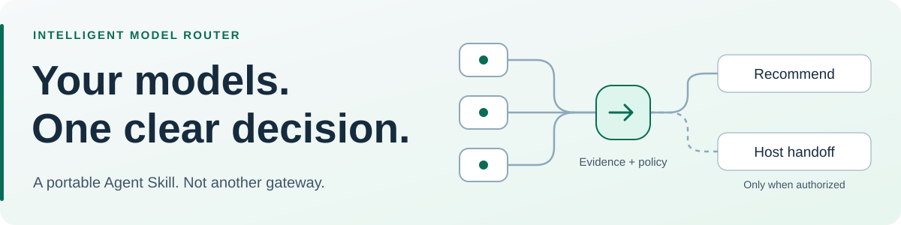
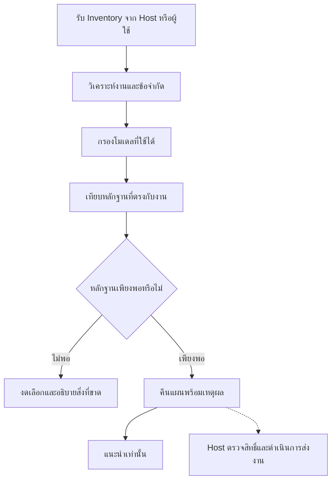

<picture>
  <source media="(prefers-color-scheme: dark)" srcset="assets/banner-dark.svg">
  <source media="(prefers-color-scheme: light)" srcset="assets/banner-light.svg">
  
</picture>

# Intelligent Model Router Skills

**ใช้โมเดลที่คุณมีอยู่แล้ว เลือกด้วยหลักฐานที่ตรวจสอบได้**

[Agent Skill](https://agentskills.io/specification) ที่ไม่ผูกกับ Provider ช่วยเลือกโมเดล
**ก่อนส่งต่องานหรือสร้าง Sub-agent** โดยเริ่มจากรายการที่คุณเข้าถึงได้ ตรวจข้อจำกัด
และคืนแผนพร้อมเหตุผล **Host ยังคงเป็นผู้ควบคุมการดำเนินการและสิทธิ์ทั้งหมด**

[](https://github.com/whale-devx/intelligent-model-router-skills/actions/workflows/ci.yml)
[](#current-status)
[](../LICENSE)

[**เริ่มใช้งาน**](#quick-start) · [**การทำงาน**](#how-it-works) · [**เอกสาร**](README.md) · [**แผนพัฒนา**](ROADMAP.md) · [**English**](../README.md)

> [!IMPORTANT]
> **0.1.0-alpha.1 เป็นตัวช่วยอ้างอิงแบบออฟไลน์** ปัจจุบันรับ Inventory และหลักฐานจาก Host
> หรือผู้ใช้ ยังไม่มีตัวค้นบัญชีอัตโนมัติ ตัวดึง Leaderboard สด หรือ Native Execution Adapter
> การติดตั้ง Skill ไม่ได้แทนที่โหมด Auto ของ Host [ดูสถานะปัจจุบัน](#current-status)

<a name="quick-start"></a>

## เริ่มใช้งาน

### 1. ติดตั้ง Skill

รันในโปรเจกต์ของคุณ แล้วเลือก Agent จากตัวติดตั้ง:

```sh
npx skills add whale-devx/intelligent-model-router-skills --skill intelligent-model-router
```

[วิธีติดตั้งสำหรับแต่ละเอเจนต์และการใช้งานผ่าน API (ภาษาอังกฤษ)](PORTABILITY.md)

ใช้ Node.js รุ่นที่ [Skills CLI รองรับ](https://github.com/vercel-labs/skills#install-a-skill)
ไม่ต้องมี Python หากใช้เฉพาะคำสั่งและแนวทางใน Skill

<details>
<summary>ติดตั้งข้ามโปรเจกต์ เลือก Agent หรือติดตั้งด้วยตนเอง</summary>

เพิ่ม `-g` เพื่อติดตั้งระดับผู้ใช้:

```sh
npx skills add whale-devx/intelligent-model-router-skills --skill intelligent-model-router -g
```

ระบุ Agent เป้าหมายของตัวติดตั้งด้วย `-a` เช่น:

```sh
npx skills add whale-devx/intelligent-model-router-skills --skill intelligent-model-router -a claude-code
```

การระบุเป้าหมายติดตั้ง **ไม่ใช่การรับรองว่าทดสอบ Host นั้นผ่านแล้ว**
ดู [รายการทดสอบ Host](HOST-TESTS.md) สำหรับสถานะที่ต้องพิสูจน์

สำหรับการติดตั้งด้วยตนเอง ให้คัดลอก `skills/intelligent-model-router/` ทั้งโฟลเดอร์
ไปยังตำแหน่งที่ Host ระบุ เก็บ References, Assets, Scripts และ License ไว้ครบ
ตรวจความเปลี่ยนแปลงก่อนแทนที่การติดตั้งเดิม

[รายละเอียดการติดตั้ง ความเป็นส่วนตัว และการแก้ปัญหา](GETTING-STARTED.md)

</details>

### 2. ให้ Agent เรียกใช้ Skill

```text
ก่อนสร้าง Sub-agent ให้ใช้ intelligent-model-router
ตรวจโมเดลที่ Host เปิดให้ฉันใช้จริง โดยไม่เดาสิทธิ์จากชื่อโมเดล
เลือกโมเดลตามงานของแต่ละ Sub-agent และหลักฐานที่เกี่ยวข้อง
รักษาสิทธิ์ กฎความเป็นส่วนตัว และงบประมาณเดิม
ถ้าหลักฐานไม่พอ ให้อธิบายว่าขาดอะไร
ถ้า Host ส่งงานต่อไม่ได้ ให้แนะนำโดยไม่เปลี่ยนค่าระบบ
```

### 3. ตรวจแผนก่อนส่งงาน

ผลลัพธ์ควรระบุโมเดล เหตุผล วันที่ของหลักฐาน ตัวเลือกที่ถูกตัดออก และสถานะการดำเนินการ
ตัวช่วย **ไม่เรียกโมเดลเอง** Host ต้องตรวจสิทธิ์อีกครั้งและยืนยันผลการส่งงานจริง

**ไม่ต้องสมัครบริการ Inference ใหม่ ไม่ต้องมี Gateway หรือ Server** ตัว Skill และ Scripts
ไม่มี Telemetry แต่ตัวติดตั้งภายนอกมี [การตั้งค่า Telemetry แยกต่างหาก](GETTING-STARTED.md#installer-privacy)

## ใช้กับงานแบบไหน

| สิ่งที่คุณต้องการ | หน้าที่ของ Skill |
| --- | --- |
| **เลือกโมเดลสำหรับงานถัดไป** | เปรียบเทียบเฉพาะตัวเลือกที่ผ่านข้อจำกัด ด้วยหลักฐานที่ตรงกับงาน |
| **สร้าง Sub-agent หลายบทบาท** | แนะนำโมเดลตามงานจริงของแต่ละตัว โดยไม่เพิ่มสิทธิ์ |
| **ทบทวนโมเดลหรือวางแผน Fallback** | ตัดสินใจใหม่เมื่อถึงจุดส่งต่องานที่ปลอดภัย ไม่ผ่อน Policy โดยเงียบ ๆ |

Skill เลือกจาก **โมเดลที่คุณมีสิทธิ์ใช้** ไม่ใช่ทุกโมเดลใน Leaderboard
และไม่ใช่บริการขายโมเดล Inference Proxy หรือ Agent Runtime

<a name="how-it-works"></a>

## ทำงานอย่างไร



**ลำดับการทำงาน:** Inventory → ข้อจำกัด → หลักฐานที่เทียบกันได้ → แผน หรือการงดเลือกอย่างมีเหตุผล
เส้นประคือขั้นตอนของ **Host ภายนอก** ไม่ใช่การทำงานของตัวช่วยออฟไลน์
การมีชื่อใน Catalog ไม่ใช่หลักฐานว่ามีสิทธิ์ และแผนไม่ใช่หลักฐานว่าสั่งงานสำเร็จ

รายละเอียดอยู่ใน [Routing Contract](../skills/intelligent-model-router/references/contract.md)

<a name="current-status"></a>

## สถานะปัจจุบัน

| มีแล้วใน Alpha | ยังไม่มีหรือยังไม่ได้ยืนยัน |
| --- | --- |
| `SKILL.md` และการใช้แบบคำสั่งล้วน | ยังไม่มีบันทึกผลทดสอบการใช้งานกับ Host จริง |
| Discovery Protocol และการนำเข้า Inventory จากไฟล์ | การค้นโมเดลจากบัญชีของ Host อัตโนมัติ |
| การกรองข้อจำกัดและจัดอันดับแบบออฟไลน์ | ตัวดึง Leaderboard สดและ Native Execution Adapter |
| แหล่งที่มา Model Identity และการป้องกันข้อมูลซ้ำ | การทำนายโอกาสสำเร็จที่ผ่าน Calibration และ Learned Routing |
| แผนการส่งงานที่ตรวจสิทธิ์และจุดส่งต่อ | การสลับโมเดลหรือสร้าง Sub-agent ได้บนทุก Host |

Badge แสดงผล **การทดสอบออฟไลน์บน `main`** ไม่ใช่การรับรอง Host ความปลอดภัย หรือผลประหยัดต้นทุน

**กติกาของหลักฐาน:** ไม่รู้ไม่ใช่ศูนย์ ความนิยมไม่ใช่ความสามารถ ความชอบไม่ใช่ความถูกต้อง
และคะแนน Leaderboard ไม่ใช่ความน่าจะเป็นที่งานของคุณจะสำเร็จ

<details>
<summary>ถ้าข้อมูลไม่ครบ จะเกิดอะไรขึ้น?</summary>

| ผลลัพธ์ | ความหมาย |
| --- | --- |
| `needs_inventory` | ต้องมีรายการโมเดลที่ได้รับอนุญาตก่อน |
| `no_eligible_models` | ไม่มีโมเดลที่ผ่านข้อจำกัดปัจจุบัน |
| `insufficient_evidence` | ขาดหลักฐานที่ใหม่พอและเทียบกันได้ |
| `selected` | เลือกโมเดลแล้ว แต่ยังต้องให้ Host ดำเนินการแยกต่างหาก |

ข้อมูลผิดรูปแบบจะถูกปฏิเสธ ไม่ถือว่าราคาที่ไม่รู้คือฟรี และไม่เติมคะแนนที่หายไปโดยไม่แจ้ง

</details>

## ทดลองตัวอย่างออฟไลน์

ใช้ **โมเดลและคะแนนสมมติ** เพื่อสาธิตพฤติกรรม ไม่ใช่ผล Benchmark จริง
จาก Repository Checkout ที่มี Python 3.10+:

```sh
python skills/intelligent-model-router/scripts/route.py --input skills/intelligent-model-router/assets/example-request.json --as-of 2026-11-20
```

ผลลัพธ์ย่อ:

```json
{
  "status": "selected",
  "selected": {"id": "example-b"},
  "action": "recommend",
  "execution_status": "not_executed",
  "estimated_success_probability": null
}
```

ข้อมูลสมมติไม่สามารถใช้วางแผนสั่งงานจริง วันที่คงที่มีไว้ทำซ้ำตัวอย่างเท่านั้น
คำขอจริงต้องใช้ข้อมูลปัจจุบัน ไม่เลื่อนวันเพื่อให้หลักฐานเก่าผ่านเกณฑ์

<details>
<summary>สำหรับผู้พัฒนา: รันชุดทดสอบออฟไลน์</summary>

```sh
python -m unittest discover -s tests -v
```

Scripts ใช้ Python Standard Library เท่านั้น ดู [แนวทางร่วมพัฒนา](../CONTRIBUTING.md)

</details>

## ไปต่อทางไหน

| เป้าหมาย | เอกสาร |
| --- | --- |
| ติดตั้งและแก้ปัญหา | [Getting Started](GETTING-STARTED.md) |
| ดูเอกสารทั้งหมด | [Documentation Hub](README.md) |
| เชื่อม Host หรือเตรียม Inventory | [Host Protocol](../skills/intelligent-model-router/references/host-protocol.md) |
| เข้าใจคะแนนและหลักฐาน | [Contract](../skills/intelligent-model-router/references/contract.md) · [Source Guide](../skills/intelligent-model-router/references/sources.md) |
| รายงานผลทดสอบหรือปัญหา | [Host Checklist](HOST-TESTS.md) · [เปิด Issue](https://github.com/whale-devx/intelligent-model-router-skills/issues/new/choose) |
| ร่วมพัฒนารุ่นถัดไป | [Roadmap](ROADMAP.md) · [Contributing](../CONTRIBUTING.md) |

ช่วยได้ทั้งแก้เอกสาร แปลภาษา หรือบันทึกผลทดสอบที่ทำซ้ำได้ รวมถึงกรณีที่ไม่ผ่านและยังไม่ทราบผล
อย่าใส่ Credentials, Inventory ส่วนตัว หรือ Prompt ลับใน Issue สาธารณะ
การรายงานช่องโหว่ให้ทำตาม [SECURITY.md](../SECURITY.md)

## สัญญาอนุญาต

โค้ดและคำสั่งที่โครงการเขียนใช้ [Apache-2.0](../LICENSE) ข้อมูล Benchmark และเครื่องหมายการค้า
อยู่ภายใต้เงื่อนไขของเจ้าของเดิม คู่มือแหล่งข้อมูลไม่ใช่สิทธิ์เผยแพร่ข้อมูลต่อ
โครงการไม่ได้รับการรับรองจากเจ้าของ Benchmark หรือ Host

[Changelog](../CHANGELOG.md) · [Security](../SECURITY.md) · [กลับด้านบน](#intelligent-model-router-skills)

[นำเข้าคะแนนความชอบด้านข้อความภาษาอังกฤษจาก snapshot ของ Arena](../skills/intelligent-model-router/references/arena.md)

ใช้ `--request request.json` เพื่อตรวจว่า mapping ของ Arena ตรงกับ endpoint ในคำขอ
Router จะไม่นำคีย์จากการสำรวจที่ขึ้นต้นด้วย `unmapped:` มาใช้เป็นคะแนนคุณภาพ
เมื่อเผยแพร่คะแนนที่แปลงแล้ว ให้คัดลอก `source_notice` เพื่อระบุแหล่งข้อมูล
ใบอนุญาต และวิธีแปลงข้อมูล เก็บรายงานฉบับเต็มไว้ในเครื่องเพราะมีรหัส endpoint ที่คุณตั้งไว้
